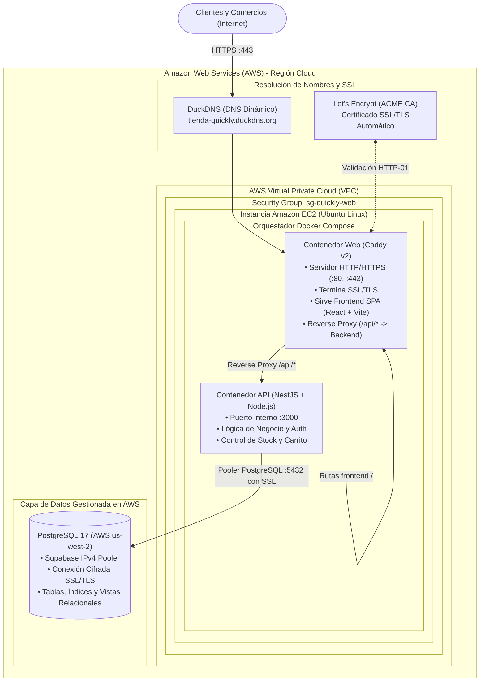
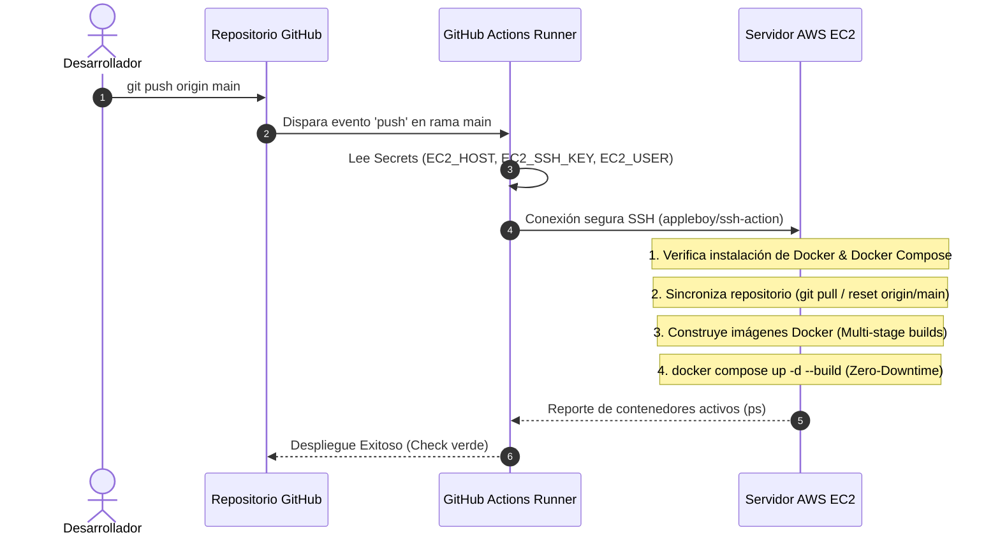

# Arquitectura y Despliegue en la Nube (AWS) - Proyecto Quickly

**Curso:** Computación en la Nube  
**Proyecto:** Plataforma de Comercio Electrónico y Delivery "Quickly"  
**Repositorio:** [github.com/The-Nasa/Practica-Cloud](https://github.com/The-Nasa/Practica-Cloud)  
**URL de Producción:** [https://tienda-quickly.duckdns.org](https://tienda-quickly.duckdns.org)  

---

## 1. Resumen Ejecutivo

El presente proyecto implementa el despliegue en la nube de una plataforma completa de comercio electrónico y delivery distribuida en una **Arquitectura de Tres Capas (Three-Tier Architecture)**. El sistema integra un cliente web interactivo (**Frontend**), un servicio de procesamiento de pedidos y catálogo (**Backend API**), y un motor relacional de persistencia transaccional (**Base de Datos**), respaldado por una infraestructura segura en **Amazon Web Services (AWS)** con automatización continua mediante **GitHub Actions (CI/CD)**.

---

## 2. Diagrama de Arquitectura en AWS

---

## 3. Descripción de las 3 Capas de la Arquitectura

### Capa 1: Presentación (Frontend)
* **Tecnología:** React 18, Vite, TypeScript, Tailwind CSS.
* **Empaquetado y Servidor:** Contenedor Docker basado en `caddy:2-alpine`.
* **Funcionalidades:**
  * Catálogo de productos interactivo, filtrado por categorías y comercios.
  * Carrito de compras reactivo en memoria local con persistencia y control de revisiones concurrentes.
  * Integración de autenticación dual: Credenciales nativas (Email/Password) y Google OAuth 2.0.
  * Polyfill universal para generación de identificadores UUID (`uuidPolyfill.ts`) garantizando compatibilidad bajo cualquier contexto de red.

### Capa 2: Lógica de Negocio (Backend)
* **Tecnología:** NestJS (Node.js), TypeScript.
* **Patrón de Diseño:** Arquitectura Modular y Orientada al Dominio (DDD) por módulos (`catalog`, `ordering`, `identity`, `merchant`, `platform`).
* **Seguridad:**
  * Manejo de sesiones mediante cookies seguras con banderas `HttpOnly` y `SameSite`.
  * Validación estricta de esquemas y DTOs mediante pipes de NestJS y `Zod`.
  * Verificación de salud del sistema mediante endpoints dedicados (`/api/v1/health/ready`).

### Capa 3: Persistencia de Datos (Database)
* **Tecnología:** PostgreSQL 17 (alojado en la infraestructura de AWS vía Supabase en la región `us-west-2`).
* **Seguridad y Conectividad:**
  * Conexión forzada con cifrado TLS/SSL (`DATABASE_SSL=true`).
  * Pool de conexiones optimizado mediante Supavisor Pooler en modo sesión.
  * Esquema relacional con separación de dominios: identidades, catálogo, órdenes, comercios y auditoría.

---

## 4. Estrategia de Red y Reverse Proxy (Caddy)

En lugar de exponer el backend directamente a Internet, se utiliza **Caddy** como punto de entrada único:

1. **Terminación SSL/TLS Automática:** Caddy negocia y renueva certificados SSL automáticamente con **Let's Encrypt** mediante el protocolo ACME para el dominio `tienda-quickly.duckdns.org`.
2. **Ruteo de Rutas Relativas:** 
   * Las solicitudes a `/api/*` se desvían de manera transparente al contenedor del backend (`api:3000`).
   * El resto de solicitudes sirven los archivos estáticos de la aplicación web SPA con soporte de *fallback* a `/index.html`.
3. **Eliminación de Problemas de CORS:** Al servirse el Frontend y el Backend bajo el mismo origen (`https://tienda-quickly.duckdns.org`), se evitan bloqueos de peticiones cruzadas en los navegadores.
4. **Cabeceras de Seguridad Reforzadas:**
   * `Content-Security-Policy (CSP)`: Permite únicamente scripts de confianza (Google Identity Services) y recursos multimedia externos (CDN de Unsplash y avatares).
   * `X-Frame-Options: SAMEORIGIN` y `X-Content-Type-Options: nosniff`.
   * `Strict-Transport-Security (HSTS)` para forzar tráfico HTTPS.

---

## 5. Pipeline de Integración y Despliegue Continuo (CI/CD)

El ciclo de entrega se encuentra 100% automatizado mediante **GitHub Actions**:

### Secretos Gestionados en GitHub:
* `EC2_HOST`: Dirección IP pública del servidor AWS EC2.
* `EC2_USER`: Usuario administrador del sistema operativo (`ubuntu`).
* `EC2_SSH_KEY`: Clave privada RSA (`.pem`) generada en AWS para acceso SSH sin contraseña.

---

## 6. Configuración de Seguridad en AWS (Grupos de Seguridad)

El cortafuegos perimetral virtual (**Security Group**) de la instancia EC2 se configuró siguiendo el **Principio de Menor Privilegio**:

| Tipo de Tráfico | Puerto | Protocolo | Origen | Justificación |
|---|---|---|---|---|
| **HTTPS** | `443` | TCP | `0.0.0.0/0` | Acceso seguro de clientes a la tienda vía TLS/SSL. |
| **HTTP** | `80` | TCP | `0.0.0.0/0` | Desvío automático a HTTPS y emisión de certificados ACME. |
| **SSH** | `22` | TCP | `0.0.0.0/0` / `IP Admin` | Acceso de administración y conexión del agente GitHub Actions. |
| **Backend API** | `3000` | TCP | *Bloqueado externamente* | Accesible únicamente a nivel interno entre contenedores Docker. |
| **PostgreSQL Local** | `5432` | TCP | *Bloqueado externamente* | Aislado dentro de la red privada de Docker (`bridge network`). |

---

## 7. Análisis de Costos y Capa Gratuita (FinOps)

El despliegue está optimizado para mantenerse dentro de los límites del **AWS Free Tier (Capa Gratuita de 12 meses)**:

1. **Amazon EC2:** Uso de instancias de la familia `t` elegibles para la capa gratuita (hasta 750 horas mensuales sin costo).
2. **Amazon EBS:** 8 a 20 GB de almacenamiento SSD gp3 (dentro del límite de 30 GB gratuitos de EBS).
3. **Caddy & Let's Encrypt:** Emisión y renovación de certificados TLS sin costo de licencias de CA comercial.
4. **Base de Datos:** Alojada en infraestructura de AWS utilizando el plan gratuito de Supabase (PostgreSQL gestionado con copias de seguridad automáticas).

**Costo Total Estimado de Operación:** **$0.00 USD / mes** durante el periodo de evaluación académica.
