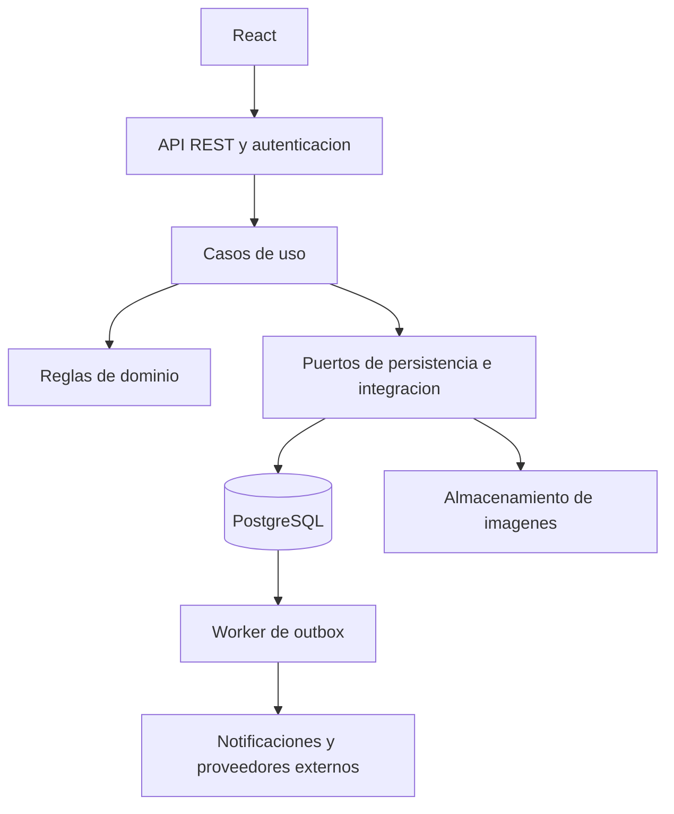
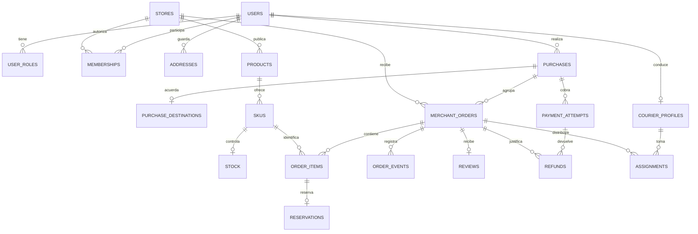

# Backend de Quickly: arquitectura mantenible y base de datos en 3FN

Fecha de preparación: 22 de octubre de 2026.

**Actualización F0, 26 de octubre de 2026:** este documento conserva el diseño objetivo original. Ya existe una API NestJS parcial en `src/`, reparada contra el baseline y probada mediante `npm run harness:check`. La persistencia vigente es `pg`, no Prisma; la sesión vigente es Bearer opaco, con cookie web prevista para F1. El estado ejecutable y sus límites se describen en [README.md](README.md); decisiones y fases se mantienen en `../docs/harness/`. Las afirmaciones históricas siguientes sobre ausencia de API o elecciones futuras deben leerse con esta actualización.

**Actualización F1:** la sesión Bearer de F0 fue reemplazada por cookie HttpOnly, CSRF y validación de Origin. Registro/login/perfil ya están integrados con React; OpenAPI y tipos se comprueban mediante el harness integral. Las elecciones y límites actuales están en README y `../docs/harness/EVIDENCIA_F1.md`.

Este documento propone la base técnica del backend a partir del frontend existente. Incluye decisiones, modelo de datos, reglas de integridad, contratos, implementación por etapas y verificación. **Es una propuesta implementable; todavía no existe una API de producción en este repositorio.**

Archivos relacionados:

- [001_schema.sql](./001_schema.sql): creación transaccional del esquema PostgreSQL, catálogos, restricciones, índices, vistas y triggers.
- [002_verificar.sql](./002_verificar.sql): pruebas SQL de integridad; sus datos se revierten con `ROLLBACK`.
- [README.md](./README.md): instrucciones para ejecutar y verificar los scripts.

## 1. Decisión recomendada

**TypeScript, Node.js LTS, NestJS, PostgreSQL y Prisma, con un monolito modular y separación entre dominio, aplicación e infraestructura.**

Supuestos: equipo pequeño, operación inicial en Tingo María, una tienda por compra, una entrega activa por repartidor y cobro completo de cada compra. El diseño mantiene compra y pedido por comercio como conceptos distintos para permitir una ampliación posterior.

| Componente | Elección | Criterio |
| --- | --- | --- |
| Lenguaje | TypeScript con `strict` | Continuidad con React; contratos verificables durante compilación. |
| Runtime | Node.js LTS con soporte | Fijar una versión compatible en desarrollo, CI y producción. |
| Framework | NestJS | Módulos, inyección de dependencias, validación, pruebas y API documentada. |
| API inicial | REST `/api/v1` | Operaciones explícitas y clientes web/móvil independientes. |
| Contrato | OpenAPI | Documentar solicitudes, respuestas, autorización, errores y paginación. |
| Base de datos | PostgreSQL 17 o superior | Relaciones, restricciones, transacciones y bloqueos; script validable sin extensiones. |
| Persistencia | Prisma detrás de adaptadores | Tipado de consultas sin acoplar el dominio al ORM. |
| Imágenes | Almacenamiento de objetos | La DB conserva `object_key`, nunca el archivo binario. |
| Sesión web | Sesión opaca en cookie segura | Revocación central y secretos fuera de `localStorage`. |
| Tareas asíncronas iniciales | Worker + outbox PostgreSQL | Reintentos durables con la infraestructura inicial. |
| Evolución de colas | BullMQ + Redis cuando sea necesario | Separar tareas intensivas o de mayor volumen conservando idempotencia. |
| Despliegue | Contenedor de API y, cuando se active, worker | Ejecuciones independientes del mismo código modular. |

TypeScript no sustituye la validación en ejecución. Cada entrada HTTP, webhook y mensaje debe validarse. Usar un único enfoque de DTO/validación por API; Zod en el frontend no obliga a copiar todos sus esquemas al dominio del backend.

No se fijan aquí versiones exactas de NestJS o Prisma. Al iniciar, seleccionar versiones estables compatibles, fijarlas en el lockfile y registrar la decisión. No introducir una actualización de ORM junto con un cambio importante de pedidos o pagos.

## 2. Situación real del frontend y alcance inicial

Fuentes revisadas: `src/domain/types.ts`, `src/domain/orderRules.ts`, `src/domain/pricingRules.ts`, `src/store/authStore.ts`, `src/store/dataStore.ts` y `src/features/checkout/checkoutFlow.ts`.

Hallazgos que condicionan el diseño:

1. Existen cuatro roles, pero la identidad y el acceso actuales son simulados.
2. Pedidos, catálogo y otros datos se persisten en el navegador, sin coordinación entre dispositivos.
3. Ya existen transiciones de pedido y cálculos monetarios en céntimos que sirven como especificación inicial.
4. Los reembolsos actuales son simulados; no representan confirmación de una pasarela.
5. El README describe multitienda, pero `validateCartSelection` exige una sola tienda por compra.
6. El mapa y el seguimiento actuales no constituyen geolocalización real.

**Alcance inicial propuesto:** una compra de una tienda, productos con SKU, efectivo, aceptación del comercio, reserva de inventario, asignación del repartidor, entrega, cancelación anterior a preparación y auditoría.

La regla de una tienda por compra se valida en `CreatePurchase`, no mediante una restricción permanente de la DB. El esquema admite varios `merchant_orders` por compra, pero **habilitar esa función exige revisar pagos, cobros en efectivo, devoluciones y experiencia de usuario**; no basta con quitar una validación.

## 3. Arquitectura de aplicación

### 3.1. Monolito modular

Una aplicación, una base transaccional y módulos con propietarios claros. Al principio la API y el worker pueden compartir despliegue; al separar el worker conservan el mismo repositorio y versión de contratos.



NestJS organiza dependencias mediante módulos. El encapsulamiento debe apoyarse además en convenciones de imports y revisiones: el framework por sí solo no impide que un archivo importe internals de otro módulo. [Referencia oficial](https://docs.nestjs.com/modules).

### 3.2. Módulos y propiedad de datos

| Módulo / schema SQL | Responsabilidad | Operaciones representativas |
| --- | --- | --- |
| `identity` | Usuarios, roles, credenciales y sesiones | Registrar, autenticar, cerrar sesión, recuperar acceso. |
| `geography` | Direcciones y cobertura | Gestionar direcciones y validar zona operativa. |
| `merchant` | Comercios, miembros y horarios | Aprobar tienda, definir operadores, abrir recepción de pedidos. |
| `catalog` | Productos, categorías, SKU e imágenes | Publicar, modificar disponibilidad y precio. |
| `ordering` | Compra, pedido por tienda, líneas y transiciones | Crear, confirmar, preparar, cancelar y valorar. |
| `inventory` | Existencias físicas y reservas | Reservar, liberar, consumir y ajustar. |
| `billing` | Intentos de cobro, reembolsos y webhooks | Iniciar cobro, confirmar, conciliar y reembolsar. |
| `delivery` | Perfil de repartidor, asignaciones e incidentes | Tomar entrega, retirar, entregar y reportar problema. |
| `support` | Conversaciones de soporte | Abrir ticket, responder y resolver. |
| `platform` | Idempotencia, auditoría, outbox y notificaciones | Funciones transversales con interfaces pequeñas. |

Los schemas SQL agrupan objetos, **no son microservicios ni una autorización automática**. Hay claves foráneas entre módulos porque comparten una base relacional. Una futura extracción requiere revisar esas dependencias, contratos y propiedad de datos. [Schemas en PostgreSQL](https://www.postgresql.org/docs/17/ddl-schemas.html).

### 3.3. Capas y dependencias

```text
src/
  main.ts
  app.module.ts
  modules/
    ordering/
      ordering.module.ts
      public.ts
      domain/
        order.ts
        order-status.ts
        order-policy.ts
      application/
        create-purchase.use-case.ts
        cancel-order.use-case.ts
        ports/
          order-repository.ts
          checkout-unit-of-work.ts
      infrastructure/
        http/
          orders.controller.ts
          dto/
        persistence/
          prisma-order.repository.ts
          prisma-checkout-unit-of-work.ts
    inventory/
    billing/
    identity/
    ...
  platform/
    config/
    database/
    observability/
    outbox/
  workers/
    outbox-worker.ts
```

Reglas de dependencia:

- El dominio usa TypeScript y reglas de negocio; no importa NestJS, Prisma, HTTP ni React.
- La aplicación coordina casos de uso mediante puertos definidos para sus necesidades.
- La infraestructura implementa esos puertos y transforma modelos de DB en modelos de aplicación.
- Los controladores validan y delegan; no calculan cobros ni deciden transiciones.
- Los módulos publican una fachada pequeña en `public.ts`; no se importan sus repositorios internos desde otros módulos.
- Las consultas de reportes pueden utilizar vistas/joins mediante un adaptador de lectura. No se necesitan repositorios genéricos para cada tabla.
- No crear una carpeta `shared` que concentre todas las reglas ni una clase base de servicio para todos los módulos.

**Transacciones entre módulos:** `CreatePurchase` utiliza una unidad de trabajo explícita que implementa infraestructura. Esa implementación comparte una transacción real entre pedidos, reservas, idempotencia y outbox. No crear una transacción diferente en cada repositorio ni filtrar el tipo de Prisma hacia el dominio.

Evitar un bus de comandos, CQRS completo o event sourcing hasta que exista una necesidad comprobada. La tabla de eventos de pedido es historial de transiciones; no convierte al sistema en event sourcing.

### 3.4. Repositorio, contratos y migraciones

Si se unifican frontend y backend más adelante, una estructura posible es `apps/web`, `apps/api`, `apps/worker` y `packages/api-client`. No mover el frontend existente solamente para iniciar el backend. Un repositorio backend separado también es válido.

Compartir contratos públicos o un cliente generado desde OpenAPI. No compartir entidades Prisma con React ni importar `src/domain/types.ts` directamente como esquema persistente: los tipos actuales combinan datos históricos, datos actuales y campos calculados.

**Una sola fuente de migraciones:** adoptar `001_schema.sql` como baseline inicial revisada. Si se elige Prisma Migrate, integrar esa SQL como primera migración y registrar el baseline según corresponda. Introspectar con `prisma db pull` permite generar modelos, pero no reemplaza el historial de migraciones ni garantiza representar todos los triggers, índices parciales y vistas. Cada SQL generado debe revisarse. No ejecutar `db push` sobre producción.

## 4. Modelo relacional y justificación de 3FN

### 4.1. Criterio usado

- **1FN:** una fila representa un hecho; no hay listas de productos, imágenes, roles o mensajes dentro de columnas de negocio.
- **2FN:** en claves compuestas, los atributos no clave dependen de la clave completa.
- **3FN:** para cada dependencia funcional no trivial `X -> A`, `X` debe ser superclave o `A` atributo primo. En las entidades propuestas se evita que un atributo no clave dependa de otro atributo no clave.

La normalización se razona a partir de dependencias del negocio, no de la cantidad de tablas ni de que todas tengan un UUID. Las restricciones documentan varias de esas dependencias; otras, como la titularidad de la solicitud, pertenecen al caso de uso.

Ejemplos de transformación:

| Diseño que se evita | Dependencia problemática | Diseño propuesto |
| --- | --- | --- |
| Pedido con `store_id`, `store_name`, `store_phone` actuales | `store_id -> nombre/teléfono actual` | FK a `merchant.stores`; lectura mediante join. |
| Reserva con `order_item_id`, `sku_id`, `quantity` | `order_item_id -> sku_id, quantity` | Reserva guarda solo su línea; SKU y cantidad se obtienen de ella. |
| Reseña con pedido, cliente, comercio y nombre del cliente | El pedido determina comprador y comercio | Reseña referencia al pedido; autor y comercio se derivan. |
| SKU con `product_id` y `store_id` | `product_id -> store_id` | SKU referencia solo producto. |
| Comercio con lista de usuarios o un usuario por rol | Relaciones multivaluadas | `memberships` y `user_roles`. |
| Pedido con subtotal y total actualizables | Valores calculables de sus componentes | Vistas `order_totals` y `purchase_totals`. |
| Producto con `price` y variantes con diferencias | Dos lugares para el precio vendible | Precio absoluto por SKU, incluyendo un SKU estándar. |

### 4.2. Identidad histórica frente a datos actuales

`product_name_at_sale`, `variant_name_at_sale` y `unit_price_cents` son las condiciones pactadas de una línea de venta. **No significan el nombre o precio actual del SKU.** Un mismo SKU puede venderse con otro precio o nombre en fechas diferentes; `sku_id` no determina esas condiciones históricas.

`purchase_destinations` representa el destino acordado de una compra. No contiene `address_id` ni `customer_id`: su identidad es la compra y no se sincroniza con la libreta de direcciones. Se copia después de comprobar que la dirección seleccionada pertenece al comprador. El domicilio de la compra permanece inmutable aunque el cliente edite o archive su dirección actual.

Los datos del destinatario pueden ser distintos del perfil del comprador. No derivarlos de `identity.users` al mostrar un pedido histórico.

Los estados de `merchant_orders` y los registros de `order_events` representan dos hechos: estado vigente e historial de transiciones. Se escriben en una transacción. La DB impide rutas de transición inválidas, pero el servicio debe insertar el evento y la auditoría correspondientes.

### 4.3. Datos derivados que no se persisten

| Dato | Fuente |
| --- | --- |
| Subtotal de línea | Precio de venta × cantidad. |
| Subtotal y total del pedido | Vista `ordering.order_totals`. |
| Total de compra | Vista `ordering.purchase_totals`. |
| Estado agrupador de compra | Vista `ordering.purchase_states`. |
| Stock disponible | Vista `inventory.availability`. |
| Promedio y número de valoraciones | Vista `merchant.ratings`. |
| Entrega activa del repartidor | Asignaciones con estado activo. |
| Notificación leída | `read_at IS NOT NULL`. |
| Resumen de ganancias operativas | Tarifas acordadas de asignaciones entregadas. |

El importe de un intento de cobro y la tarifa acordada con un repartidor sí se guardan: son hechos económicos independientes. Un cobro puede fallar y los costes del reparto no tienen por qué coincidir con la tarifa cobrada al cliente.

Los importes de pedido corresponden al acuerdo original incluso después de una cancelación. El neto financiero se calcula con cobros confirmados y reembolsos confirmados; no se reescribe la venta original.

### 4.4. Uso limitado de JSONB

El núcleo relacional no almacena productos, roles o líneas de venta en JSON. Hay JSONB únicamente en sobres de integración: payload recibido de proveedores, respuesta idempotente, detalles de auditoría y eventos de outbox.

Esos documentos son mensajes opacos o evidencia técnica, no la fuente de verdad relacional. Su contenido puede repetir datos al serializar un evento; esa repetición es una decisión de integración explícita, externa al modelo normalizado del negocio. Si un campo necesita búsquedas, restricciones y relaciones de negocio, incorporarlo como columna/tabla mediante una migración.

## 5. Relaciones principales



El diagrama muestra cardinalidades estructurales del DDL. La aplicación exige una compra con destino y al menos un pedido/línea al confirmar, un SKU con stock inicializado al publicar y una sola tienda en el MVP. Las FK garantizan que un hijo tenga padre, no que todo padre tenga al menos un hijo.

## 6. Diccionario de tablas y dependencias

En todas las tablas con `id`, ese identificador es PK. El SQL es la referencia completa de tipos, nulabilidad y restricciones. Esta tabla resume las dependencias que justifican la descomposición.

| Tabla | Clave / alternativa importante | Hecho representado |
| --- | --- | --- |
| `identity.users` | `id`; email único; teléfono único | Perfil y estado de cuenta. |
| `identity.roles` | `code`; etiqueta única | Catálogo de roles globales. |
| `identity.user_roles` | `(user_id, role_code)` | Concesión de un rol y fecha. |
| `identity.password_credentials` | `user_id` | Hash de contraseña local. |
| `identity.external_accounts` | `(provider, provider_subject)` | Identidad externa vinculada. |
| `identity.sessions` | `id`; hash único | Sesión revocable con vencimiento. |
| `identity.password_reset_tokens` | `id`; hash único | Token de recuperación de un solo uso. |
| `geography.coverage_zones` | `id`; código único | Zona operativa y tarifa vigente. |
| `geography.addresses` | `id` | Dirección actual de la libreta de un usuario. |
| `merchant.categories` | `code` | Rubro del comercio. |
| `merchant.stores` | `id` | Perfil operativo de una tienda. |
| `merchant.memberships` | `(store_id, user_id)` | Permiso de un usuario en una tienda. |
| `merchant.opening_intervals` | `id`; tienda/día/apertura únicos | Intervalo de atención semanal. |
| `catalog.categories` | `id`; código único | Clasificación de productos. |
| `catalog.products` | `id` | Descripción del producto de una tienda. |
| `catalog.skus` | `id`; código único; producto/variante únicos | Unidad vendible con precio absoluto. |
| `catalog.product_images` | `id`; producto/posición únicos | Imagen ordenada del producto. |
| `catalog.favorites` | `(user_id, store_id)` | Comercio favorito de un usuario. |
| `ordering.order_statuses` | `code` | Nombre y carácter terminal del estado. |
| `ordering.allowed_transitions` | `(from_status, to_status)` | Ruta permitida del ciclo de pedido. |
| `ordering.purchases` | `id`; código numérico único | Acto de compra de un cliente. |
| `ordering.purchase_destinations` | `purchase_id` | Destino histórico acordado. |
| `ordering.merchant_orders` | `id`; compra/tienda únicos | Pedido de una tienda, estado y tarifa pactada. |
| `ordering.order_items` | `id` | Línea histórica con SKU, condiciones y cantidad. |
| `ordering.order_events` | `id`; pedido/versión únicos | Transición observada con actor y motivo. |
| `ordering.reviews` | `merchant_order_id` | Una valoración del pedido. |
| `inventory.stock` | `sku_id` | Cantidad física del SKU. |
| `inventory.reservations` | `order_item_id` | Ciclo de una reserva de línea. |
| `billing.payment_methods` | `code` | Método de cobro. |
| `billing.payment_attempts` | `id`; proveedor/referencia únicos si hay referencia | Intento de cobrar una compra. |
| `billing.refunds` | `id`; `request_key` única | Devolución de un cobro para un pedido. |
| `billing.webhook_receipts` | `id`; proveedor/evento únicos | Recepción deduplicada de mensaje externo. |
| `delivery.courier_profiles` | `user_id` | Datos operativos del repartidor. |
| `delivery.assignments` | `id`; índices de actividad únicos | Intento de asignar y realizar una entrega. |
| `delivery.incidents` | `id` | Problema reportado en una asignación. |
| `support.tickets` | `id` | Solicitud de soporte. |
| `support.ticket_messages` | `id` | Mensaje de la conversación. |
| `platform.notifications` | `id` | Aviso dirigido a un usuario. |
| `platform.audit_entries` | `id` | Acción sobre un recurso y solicitud. |
| `platform.idempotency_keys` | `(user_id, operation, key)` | Identidad de una ejecución HTTP reintentable. |
| `platform.outbox_events` | `id` | Evento comprometido pendiente de publicar. |

Decisiones adicionales:

- Un usuario puede pertenecer a varias tiendas. Un rol global `merchant` no concede acceso a cualquier tienda.
- Email y teléfono son únicos en esta propuesta. Si el negocio permite teléfonos familiares compartidos, cambiar esa regla mediante una migración antes de registrar usuarios reales.
- `brand` se guarda como texto porque no tiene atributos adicionales. Si se administra un catálogo de marcas, introducir una entidad `brands`; no crear catálogos sin necesidad.
- Un SKU estándar evita mantener dos modelos incompatibles de precio/stock. Si las variantes actuales comparten un único stock por producto, no copiar ese stock completo en cada SKU: decidir y repartir existencias durante la migración.
- El baseline admite un reembolso no fallido por pedido; el caso de cancelación solicita la devolución completa. Si se requieren varias devoluciones parciales del mismo pedido, sustituir ese índice y validar también la suma por pedido bajo lock; no retirar solamente la unicidad.
- Las categorías de producto y de comercio son distintas: una bodega puede vender productos de categorías diferentes.
- El nombre de tienda no es único: dos comercios pueden compartir nombre comercial.
- Las zonas son operativas, no un catálogo de departamentos/provincias/distritos. Se pueden incorporar ubigeos como entidades propias si se amplía cobertura.
- Horarios: ISO lunes=1, domingo=7, hora local `America/Lima`. Dividir intervalos nocturnos; el servicio impide solapamientos y evalúa cierres especiales si se implementan.

## 7. Integridad: qué resuelve SQL y qué debe resolver la API

| Invariante | DB del script | Aplicación pendiente |
| --- | --- | --- |
| Referencias válidas | PK, FK y `NOT NULL`. | Traducir errores en respuestas útiles. |
| Cantidades e importes válidos | `CHECK`, rangos y tipos enteros. | Límites de compra, tamaño de solicitudes y reglas comerciales. |
| SKU de la tienda del pedido | Trigger en inserción de línea. | Impedir transferir productos/SKU entre tiendas; archivar y recrear si cambia propietario. |
| Condiciones históricas | Triggers contra edición/borrado de líneas y destino. | Construir la compra completa en una transacción; nunca anexar líneas después de confirmar. |
| Estado válido de pedido | Catálogo y trigger de transición/versionado. | Actor autorizado, evento, motivo y efectos asociados en la misma transacción. |
| Reserva sin sobreventa | Bloqueo del stock y validación al insertar reserva. | Bloquear SKU en orden estable; separar pasos de lectura/escritura y reintentar conflictos. |
| No ajustar por debajo de reservas | Trigger de `inventory.stock`. | Autorizar y auditar ajustes; no cambiar cantidad por errores de la UI. |
| Liberación única | Reserva terminal no reabrible ni borrable. | Cancelación cambia estado, reserva y outbox juntos. |
| Cobro exitoso único | Índice parcial por compra. | Conciliación con proveedor y prevención de cobros externos duplicados. |
| Importe cobrado | Trigger comprueba total al confirmar. | Validar firma, referencia, moneda e importe del proveedor. |
| Reembolso limitado | Trigger bloquea pago, verifica compra y suma máxima. | Proveedor idempotente, reconciliación y notificación. |
| Asignación activa única | Índices parciales por pedido y repartidor. | Pedido listo, repartidor habilitado, estado de entrega y autorización. |
| Reseña válida | Rating 1..5 y una reseña por pedido. | Autor comprador y pedido entregado. |
| Idempotencia HTTP | PK por usuario/operación/clave. | Hash de solicitud, respuesta persistida y protocolo de concurrencia. |
| Auditoría y eventos inmutables | Triggers de append-only. | Insertar registros, evitar secretos y asignar permisos de runtime. |

**Los triggers no implementan el backend completo.** El rol de aplicación no debe permitir endpoints SQL arbitrarios, cambios de catálogo de transiciones ni reescritura de identidades de recursos. El propietario de la base puede alterar triggers; por eso las credenciales de migración deben estar separadas de las de ejecución.

PostgreSQL desaconseja usar `CHECK` para reglas que dependen de otras filas/tablas. El script usa FK/índices cuando procede y triggers acotados para ciertas reglas entre tablas. [Restricciones](https://www.postgresql.org/docs/17/ddl-constraints.html).

## 8. Transacciones y concurrencia

Usar inicialmente `READ COMMITTED` con bloqueos explícitos en operaciones de escritura. Tras esperar un lock, realizar la lectura decisiva en una **sentencia posterior**, para trabajar con una instantánea actualizada. No convertir esto en una lectura libre seguida de una escritura basada en datos obsoletos.

Los triggers de reservas y reembolsos usan consultas separadas después del bloqueo. El flujo de aplicación debe conservar la misma disciplina. En `REPEATABLE READ`/`SERIALIZABLE`, implementar reintentos completos por error de serialización. [Aislamiento](https://www.postgresql.org/docs/17/transaction-iso.html), [bloqueos](https://www.postgresql.org/docs/17/explicit-locking.html).

### 8.1. Crear compra

1. Autenticar usuario y validar `Idempotency-Key`.
2. Calcular un hash canónico del cuerpo relevante y reservar la clave en una transacción.
3. Validar dirección propia, cobertura, comercio activo, horarios, mínimo y una sola tienda.
4. Bloquear filas de SKU para estabilizar precio/disponibilidad, en orden de UUID, y filas `inventory.stock` en el mismo orden. Las modificaciones de precio siguen un protocolo compatible.
5. En una sentencia posterior leer disponibilidad y agrupar cantidades por SKU. Rechazar si no alcanza.
6. Recalcular precio y envío en el servidor. El cliente envía SKU/cantidad, no el importe autoritativo.
7. Insertar compra, destino histórico, pedido, líneas y una reserva activa por línea. No existe compra confirmada con cero líneas.
8. Insertar evento inicial versión 0, auditoría y outbox; preparar respuesta usando las vistas.
9. Guardar la respuesta idempotente y confirmar la transacción.

No llamar a una pasarela ni enviar correos dentro de la transacción. Para efectivo el cobro queda pendiente. Para pago digital se crea el intento y se ejecuta la interacción externa fuera de los locks.

### 8.2. Cancelar o rechazar

Bloquear la compra y el pedido; verificar titularidad/rol y estado actual. Las cancelaciones del cliente solo se permiten en `pending` o `confirmed`. Cambiar a `cancelled` o `rejected`, cerrar reservas activas como `released`, insertar evento/versionado, auditoría y outbox; confirmar todo junto.

**No se incrementa `on_hand` al liberar una reserva**, porque la existencia física no se descontó al reservar. El stock disponible aumenta al dejar de contar esa reserva. Esto evita la doble devolución presente en implementaciones que mezclan existencias físicas y reservas.

Si ya existe cobro digital confirmado, crear solicitud de reembolso pendiente. Si el webhook de cobro llega después de la cancelación, el reconciliador detecta esa situación y solicita la devolución. Una cancelación nunca equivale automáticamente a dinero devuelto.

### 8.3. Retirar y entregar

Al retirar: comprobar asignación activa propia, bloquear pedido, asignación y stock en el orden acordado; cerrar reservas como `consumed` y después descontar sus cantidades de `on_hand`, dentro de la misma transacción. El trigger de stock comprueba las reservas que siguen activas. Registrar retiro y pasar el pedido a `in_transit` con evento.

Al entregar: cerrar asignación y pedido, registrar evento/auditoría. Para efectivo, confirmar el intento de pago con usuario cobrador e importe exacto de compra en esa transacción. El script rechaza un cobro de efectivo cuando quedan pedidos sin entregar; esto corresponde al MVP de una tienda por compra.

Una incidencia posterior al retiro no se resuelve devolviendo inventario automáticamente: el producto ya salió físicamente. Diseñar un caso de devolución/merma si el negocio lo requiere.

### 8.4. Orden de locks y errores reintentables

Definir y mantener un orden: clave idempotente, compra, pedidos ordenados por ID, perfil de repartidor, asignaciones, SKU ordenados por ID, stock en ese orden y pago. Cada caso usa el subconjunto necesario y no adquiere locks anteriores después de posteriores. Reservas de pago, conciliación y cancelación se coordinan bajo la compra.

El ajuste de inventario toma el lock de stock antes de modificarlo. La cancelación y el consumo también lo toman antes de cerrar reservas. El trigger de reserva añade una defensa para inserciones, pero no reemplaza el orden global de aplicación.

Reintentar la transacción completa con límite y espera breve aleatoria en `40001` (serialización) y `40P01` (deadlock), conservando la clave idempotente. `23505` no siempre significa reintentar: puede representar una entrega ya tomada. `23514` puede ser un conflicto comercial; mapear por restricción/operación, sin devolver SQL interno.

### 8.5. Idempotencia y outbox

Para una clave ya usada: mismo hash devuelve la respuesta guardada; hash distinto devuelve `409`. Dos solicitudes concurrentes compiten por la PK; la perdedora espera o vuelve a leer la respuesta comprometida. Si la primera transacción revierte, la segunda puede ejecutar. No borrar claves mientras un reintento razonable pueda llegar.

El outbox se escribe en la transacción de negocio. Un worker puede tomar un lote con `FOR UPDATE SKIP LOCKED` y mantener el bloqueo hasta marcar publicación. Si se necesita liberar la transacción antes de enviar, añadir una concesión con propietario y vencimiento mediante migración; la tabla inicial no contiene un sistema de leases.

Puede ocurrir un fallo después de enviar y antes de marcar publicación: la entrega es **al menos una vez**. Los consumidores deduplican por `event_id`. Para cobros/reembolsos usar también idempotencia del proveedor; la unicidad local por sí sola no impide un cargo duplicado fuera de la DB.

Las reservas con `expires_at` no dejan de contar solo por pasar la hora. Un worker coordina el vencimiento con la cancelación del pedido y marca la reserva liberada en una transacción. No liberar pedidos ya aceptados/en preparación por un temporizador genérico.

## 9. API propuesta y seguridad

### 9.1. Contratos iniciales

| Método y ruta | Propósito | Acceso |
| --- | --- | --- |
| `POST /api/v1/auth/register` | Crear cuenta cliente. | Público, limitado. |
| `POST /api/v1/auth/login` | Crear sesión real. | Público, limitado. |
| `POST /api/v1/auth/logout` | Revocar sesión. | Autenticado. |
| `POST /api/v1/auth/password-resets` | Solicitar recuperación. | Respuesta uniforme. |
| `GET /api/v1/stores` | Explorar comercios activos. | Público. |
| `GET /api/v1/stores/:id/products` | Catálogo de tienda. | Público. |
| `GET/POST /api/v1/me/addresses` | Libreta de direcciones. | Titular. |
| `POST /api/v1/checkout/quotes` | Cotizar y detectar cambios. | Cliente. |
| `POST /api/v1/purchases` | Crear compra idempotente. | Cliente. |
| `GET /api/v1/me/purchases` | Historial paginado. | Titular. |
| `POST /api/v1/orders/:id/cancellations` | Cancelar pedido. | Titular y estado permitido. |
| `POST /api/v1/merchant/orders/:id/accept` | Aceptar. | Miembro autorizado de tienda. |
| `POST /api/v1/merchant/orders/:id/start-preparation` | Iniciar preparación. | Miembro autorizado de tienda. |
| `POST /api/v1/merchant/orders/:id/mark-ready` | Solicitar recojo. | Miembro autorizado de tienda. |
| `POST /api/v1/courier/orders/:id/claim` | Tomar entrega. | Repartidor aprobado y disponible. |
| `POST /api/v1/courier/assignments/:id/pickup` | Registrar retiro. | Repartidor asignado. |
| `POST /api/v1/courier/assignments/:id/deliver` | Registrar entrega. | Repartidor asignado. |
| `POST /api/v1/billing/webhooks/:provider` | Recibir confirmación externa. | Firma del proveedor. |
| `POST /api/v1/admin/stores/:id/approve` | Aprobar comercio. | Administración. |

Ejemplo de creación de compra:

```http
POST /api/v1/purchases
Idempotency-Key: <uuid-generado-por-el-cliente>
Content-Type: application/json

{
  "addressId": "<uuid>",
  "paymentMethod": "cash",
  "items": [
    { "skuId": "<uuid>", "quantity": 2, "note": "Sin aji" }
  ]
}
```

No aceptar `customerId`, `storeId`, rol, precio ni total como autoridad del cliente. El actor sale de la sesión y la tienda se obtiene del SKU. Si se detecta precio cambiado respecto de una cotización, devolver conflicto y una nueva cotización para confirmación; no cobrar silenciosamente un total distinto.

Usar errores estables como `OUT_OF_STOCK`, `PRICE_CHANGED`, `ORDER_STATE_CONFLICT` y `DELIVERY_ALREADY_CLAIMED`, junto con `requestId`. Paginar con cursor estable `(created_at, id)` y acotar tamaños de página. Definir el orden por endpoint e indexarlo según las consultas medidas.

### 9.2. Autenticación y permisos

- Hash de contraseña con un algoritmo adecuado como Argon2id; nunca texto plano ni cifrado reversible.
- Token de sesión aleatorio de alta entropía; almacenar su hash, no el secreto de la cookie.
- Cookie `HttpOnly`, `Secure` en producción, política `SameSite` acorde al despliegue y expiración explícita.
- Implementar defensa CSRF y validación de origen para mutaciones con cookies. CORS con orígenes concretos; CORS no sustituye autorización.
- Recuperación: token aleatorio, hash en DB, vencimiento, consumo único y respuesta que no revele si el email existe. Revocar sesiones según política.
- El registro público crea un cliente. Comercio y repartidor requieren aprobación; el cliente no puede concederse `admin` enviando un rol.
- Acceso a un recurso = usuario activo + rol permitido + relación con ese recurso + estado compatible.
- Verificar Google/OIDC en el servidor; el usuario simulado de `loginGoogle` no se migra como identidad verificada.
- Nunca guardar PAN/CVV; usar el mecanismo tokenizado del proveedor. Los webhooks requieren verificación antes de persistirlos como evidencia confiable.
- Limitar intentos de login, recuperación, cargas de archivos y operaciones sensibles. No registrar cookies, contraseñas ni payloads sensibles completos.

Para móvil, evaluar un contrato de tokens específico cuando exista ese cliente. No añadir JWT y sesiones web simultáneamente sin una necesidad concreta.

### 9.3. Permisos PostgreSQL

Crear roles separados de migración, API, worker y lectura operativa. El script no crea credenciales ni concede acceso general a `PUBLIC`.

El rol de API necesita solo las operaciones que implementa. Los catálogos de roles/transiciones se leen en runtime; su modificación se realiza mediante migraciones. Los registros de venta y auditoría no requieren permisos de borrado. El worker recibe permisos de lectura/escritura sobre sus colas y operaciones específicas, no privilegios de propietario.

Las secuencias `IDENTITY` pueden requerir concesiones sobre secuencias además de las tablas. Revisar `USAGE` de schemas, permisos de vistas y funciones al preparar el despliegue. No conceder `CREATE` en schemas de aplicación al rol de runtime ni usar `SECURITY DEFINER` para evitar diseñar permisos.

## 10. Convenciones de datos y evolución

- SQL en `snake_case`, código TypeScript en `camelCase`. Mantener un glosario: compra ≠ pedido de tienda ≠ asignación ≠ cobro.
- UUID como identificadores públicos. El número secuencial de compra se puede presentar como `QK-000123`; no usarlo como secreto ni como criterio de autorización.
- Céntimos enteros `bigint` y moneda única PEN. PostgreSQL/Prisma pueden devolver `bigint`; JSON no serializa el `bigint` nativo. Definir un mapper: convertir a `number` solo con `Number.isSafeInteger`, o devolver cadena decimal en todos los importes. No mezclar ambos formatos sin contrato.
- `timestamptz` para instantes; API ISO 8601 con zona, presentación `America/Lima`. Los horarios semanales usan hora local y la zona horaria de operación documentada.
- Archivar/desactivar perfiles y productos usados en operaciones. No hacer cascadas que borren historial de ventas.
- Los perfiles tienen `updated_at` mantenido por repositorios; el SQL lo actualiza automáticamente en cambios de estado y stock. No asumir que todos los timestamps se mantienen solos.
- El catálogo de estados crece mediante migraciones y actualización coordinada de reglas, API y frontend. Un nuevo código sin comportamiento implementado no es una funcionalidad completa.
- Cupones, descuentos, impuestos y comisiones no están implementados en este baseline. Cuando se incorporen, modelar ajustes con concepto, base e importe pactados; no editar el precio histórico para simularlos.
- Las ganancias operativas del repartidor no son una contabilidad. Antes de liquidaciones reales, modelar cuentas, movimientos y conciliación; no derivar saldos pagaderos únicamente de pedidos.
- No hay tracking GPS persistente todavía. Incorporar posiciones con retención y frecuencia definidas cuando se implemente, y evaluar PostGIS si se requieren búsquedas espaciales.
- Multimoneda requiere moneda y escala bien definidas en cada obligación/cobro y reglas de consistencia. No añadir solamente una columna `currency` dejando sumas incompatibles.

Cambios de DB mediante migraciones inmutables con revisión y despliegue compatible: **expandir, rellenar datos, cambiar lectores/escritores y después retirar**. Probar tanto instalación desde cero como actualización con datos de la versión anterior. Las migraciones destructivas no se revierten borrando datos: preparar recuperación y restauración comprobadas.

## 11. Pruebas y operaciones

### 11.1. Pruebas mínimas del backend

| Nivel | Casos prioritarios |
| --- | --- |
| Unitarias de dominio | Transiciones, cancelación, importes, permisos por relación. |
| Integración con PostgreSQL | FK, unicidad, vistas, reservas, rollback y límites de reembolso. |
| Concurrencia real | Dos compras para última unidad, dos claims de entrega, dos reembolsos sobre un pago. |
| HTTP | Autorización entre tiendas, validación, idempotencia y errores documentados. |
| Proveedores | Webhooks repetidos/tardíos, timeouts, reembolso pendiente y conciliación. |
| Recorrido completo | Cliente compra, tienda prepara, repartidor entrega y efectivo se registra. |

`002_verificar.sql` cubre integridad secuencial y vistas. No sustituye pruebas HTTP ni simula por sí mismo conexiones concurrentes. Incorporar pruebas de concurrencia con dos conexiones reales al implementar los casos de uso.

Durante la preparación del baseline se verificaron además tres carreras con dos conexiones reales: reservar la última unidad, aceptar la misma entrega y reembolsar el mismo cobro. En cada caso la segunda conexión esperó el lock de la primera y fue rechazada tras su commit. Estas pruebas puntuales validan mecanismos de la DB; no reemplazan la futura suite de los casos de uso.

Para consumo de reservas, verificar que cerrar reserva y reducir existencia física ocurre junto, y que un fallo revierte ambas operaciones. Para seguridad, probar un comercio intentando leer/modificar un pedido ajeno aunque conozca su UUID.

### 11.2. Operación y despliegue

Separar desarrollo, staging y producción. Guardar secretos fuera del repositorio. Ejecutar migraciones como paso controlado antes de habilitar código que dependa de ellas, con credencial distinta de la API.

Tener health/readiness checks, logs estructurados con `requestId`, alertas sobre errores de pago y métricas de latencia, reservas vencidas, pedidos sin asignar y antigüedad del outbox. Logs técnicos y auditoría de negocio tienen finalidades distintas.

Definir recuperación esperada, backups automáticos y una prueba periódica de restauración. Medir consultas con `EXPLAIN (ANALYZE, BUFFERS)` sobre datos representativos antes de añadir índices o caché. Cada índice acelera algunas lecturas y encarece escrituras; no indexar todas las columnas.

Empezar el seguimiento con consultas periódicas autenticadas. Añadir SSE/WebSocket cuando se necesite actualización inmediata; persistir primero el cambio y emitir después. Al reconectar, el cliente consulta el estado vigente de la API.

## 12. Hoja de ruta con criterios de terminación

| Etapa | Entregable | Termina cuando |
| --- | --- | --- |
| 0. Acordar reglas | Glosario, estados, una tienda por compra, política de stock/pago | No hay contradicciones entre checkout, API y modelo. |
| 1. Base técnica | NestJS, configuración, DB, migraciones, OpenAPI y CI | Una base vacía se instala y se verifican restricciones. |
| 2. Identidad | Sesión real, permisos, alta y aprobación | Un usuario no puede cambiar rol ni acceder a recursos ajenos. |
| 3. Catálogo | Comercios, productos, SKU, imágenes y direcciones | React consulta datos reales sin depender de mocks. |
| 4. Compra en efectivo | Compra, reservas y cancelación | Dos clientes no sobrevendan; reintento no duplica compra. |
| 5. Operación | Cocina, claim, retiro y entrega | Tres cuentas en dispositivos distintos completan el recorrido. |
| 6. Pagos digitales | Proveedor verificado, webhooks, reembolsos | Repeticiones y fallos se reconcilian sin duplicar dinero. |
| 7. Producción | Observabilidad, backups, restauración y runbook | Se puede diagnosticar y recuperar un incidente probado. |
| 8. Ampliación | Tracking real, promociones, reportes y multitienda | Cada función cuenta con su modelo y reglas explícitas. |

## 13. Integración progresiva con el frontend

1. Añadir servicios HTTP por funcionalidad y un cliente de API tipado.
2. Sustituir autenticación demo por sesión real y endpoint de usuario actual.
3. Migrar catálogo y direcciones; conservar estado visual/carrito en React/Zustand.
4. Cambiar checkout para enviar SKU, cantidad, dirección y método; mostrar totales del servidor.
5. Sustituir mutaciones de `dataStore` por casos de uso de la API; refrescar lecturas después de cambios.
6. Eliminar cambio de rol/tienda simulado de la compilación de producción.
7. Mantener mocks únicamente para desarrollo y pruebas, fuera de la fuente de verdad operativa.

Los DTO pueden adaptar estados backend en inglés a las etiquetas españolas existentes. Registrar un mapeo único; no traducir estados de manera diferente en cada pantalla.

## 14. Decisiones pendientes antes de operar con dinero real

- Proveedor y modalidad de Yape/Plin/tarjeta, confirmación, vencimientos y reembolsos disponibles.
- Política de aceptación de pedidos digitales: esperar confirmación de pago antes de cocina.
- Tratamiento de tiendas cerradas, incidencias, productos preparados no entregados y devoluciones posteriores.
- Comisión de plataforma, tarifa de repartidor, cobro de efectivo, liquidaciones y conciliación.
- Stock por variante o compartido, especialmente para productos de restaurante.
- Titularidad de tiendas, varios propietarios/operadores y recuperación de cuentas.
- Cobertura, horario comercial, ubicación de reparto y retención de datos personales.

Estas decisiones no bloquean la preparación técnica, pero sí determinan funcionalidades antes de habilitarlas para usuarios reales.

## 15. Referencias técnicas oficiales

- [NestJS: módulos](https://docs.nestjs.com/modules).
- [NestJS: integración con Prisma](https://docs.nestjs.com/recipes/prisma).
- [NestJS: OpenAPI](https://docs.nestjs.com/openapi/introduction).
- [NestJS: colas y BullMQ](https://docs.nestjs.com/techniques/queues).
- [Node.js: versiones y soporte](https://nodejs.org/en/about/previous-releases).
- [PostgreSQL 17: restricciones](https://www.postgresql.org/docs/17/ddl-constraints.html).
- [PostgreSQL 17: índices parciales](https://www.postgresql.org/docs/17/indexes-partial.html).
- [PostgreSQL 17: aislamiento](https://www.postgresql.org/docs/17/transaction-iso.html).
- [PostgreSQL 17: bloqueos](https://www.postgresql.org/docs/17/explicit-locking.html).
- [PostgreSQL 17: schemas](https://www.postgresql.org/docs/17/ddl-schemas.html).

Las decisiones de alcance, normalización y organización de Quickly son propuestas de este documento; las referencias sustentan los mecanismos técnicos utilizados.
